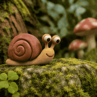

# AIGifsMaker

**[AIGifsMaker](https://aigifsmaker.com)** is an online AI GIF maker. Describe a subject and its motion, or upload a photo, and it generates an animated GIF. Free tools also convert videos and image sequences to GIF directly in the browser.

  
  
  

## Tools

| Tool | What it does | Cost |
|---|---|---|
| [Text to GIF](https://aigifsmaker.com/text-to-gif) | Generates an animated GIF from a text prompt in six styles: reaction, sticker, cinemagraph, anime, pixel and claymation | AI credits |
| [Image to GIF](https://aigifsmaker.com/image-to-gif) | Animates a single photo with AI, or combines several images into a GIF | Combining images is free |
| [Video to GIF](https://aigifsmaker.com/video-to-gif) | Converts an MP4, MOV or WebM clip into a GIF with trim, size and frame-rate controls | Free, no watermark |

Video and image conversion run locally in your browser, so your files are not uploaded to a server.

## Getting started

1. Open [aigifsmaker.com](https://aigifsmaker.com).
2. Create a free account. Verified accounts get 30 free AI credits.
3. Write a short prompt with one subject and one clear motion, such as "a kitten waves hello", then pick a style and generate.

Credits for a failed AI GIF are returned automatically. Plans and credit packs are listed on the [pricing page](https://aigifsmaker.com/pricing).

## Links

- Website: https://aigifsmaker.com
- Support: support@aigifsmaker.com
